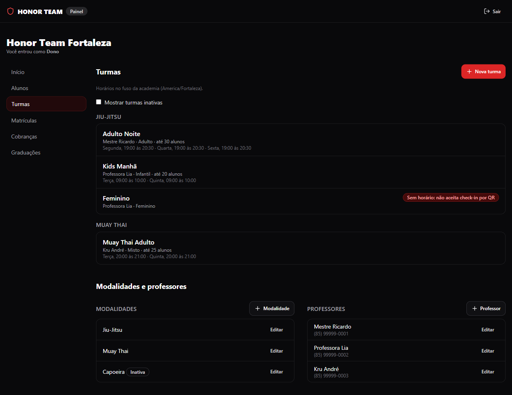
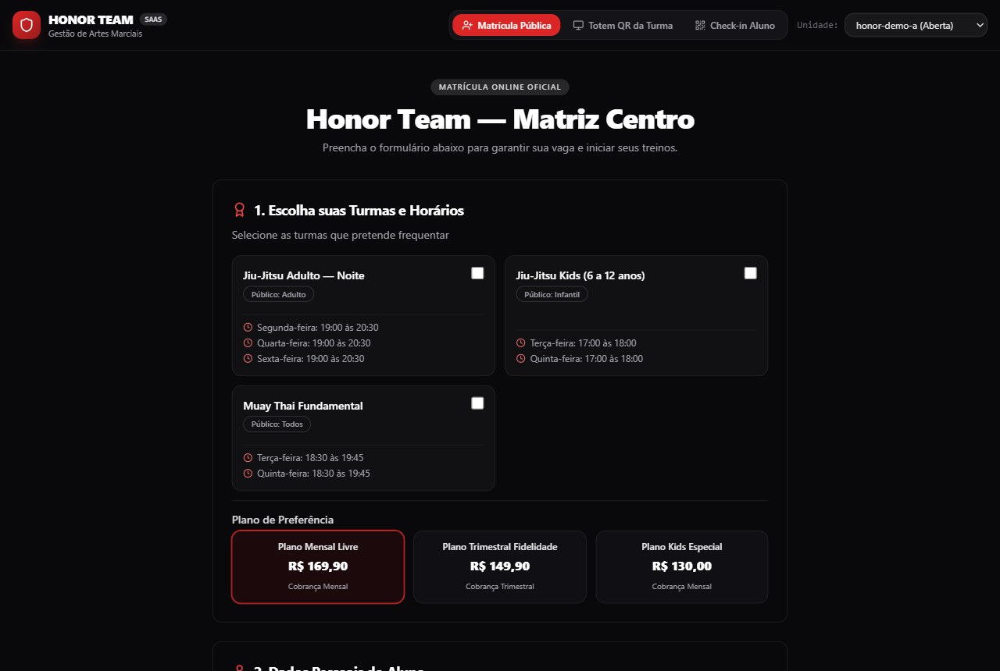
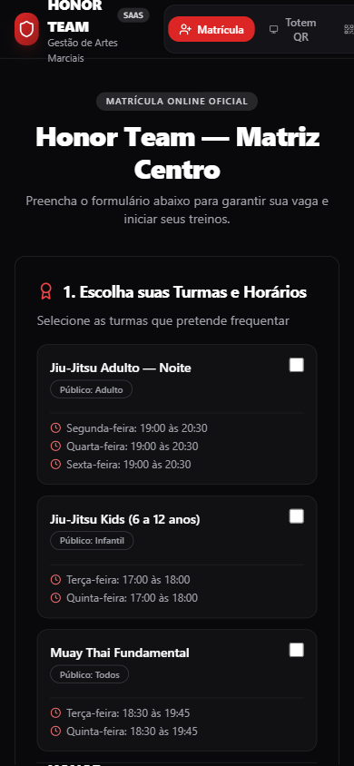
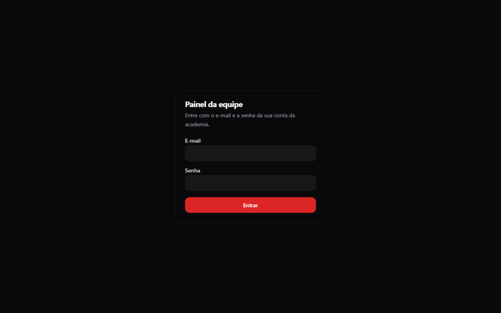
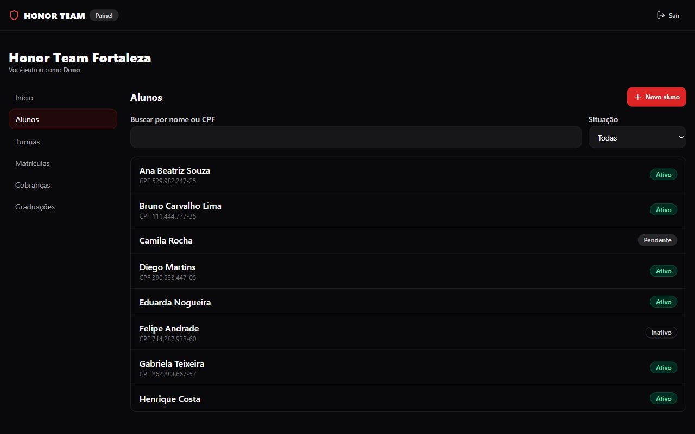
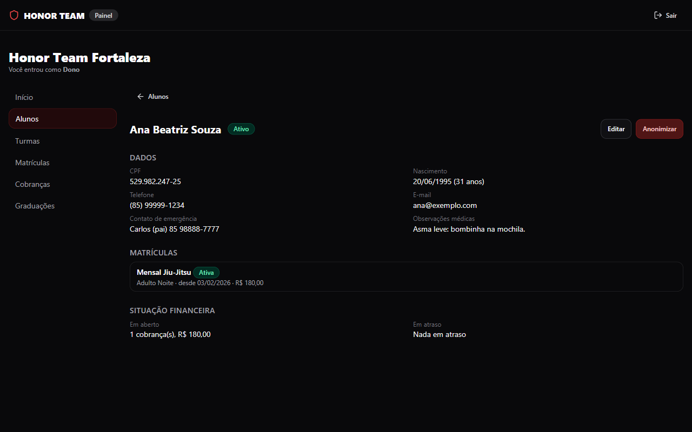
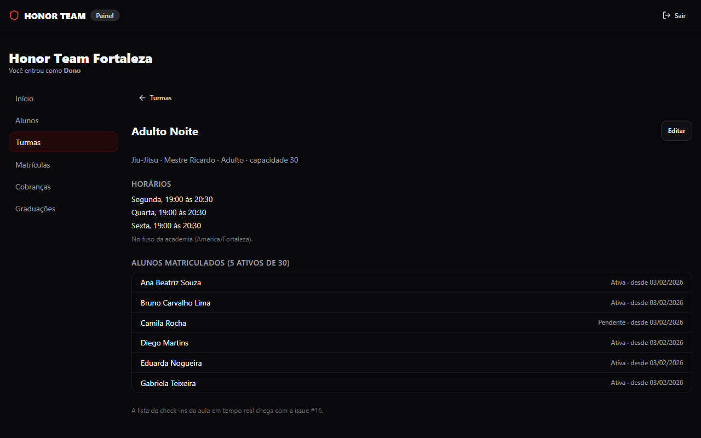
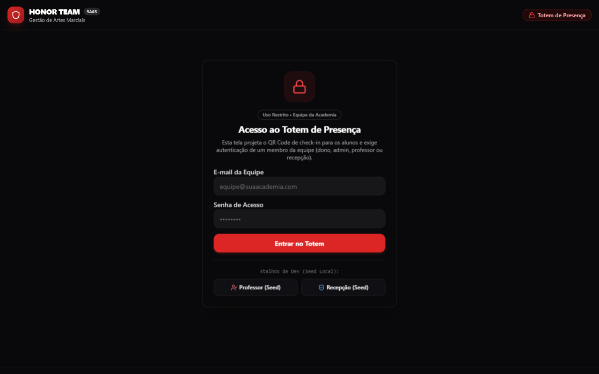

# Honor Team SaaS

Gestão para academias de artes marciais: alunos, matrícula online, turmas,
frequência por check-in, graduações (faixas e graus) e financeiro. Cada
academia é um tenant isolado no mesmo banco.



## Estado atual

O que já existe em `main`:

- **Banco** (Supabase, Postgres): schema multi-tenant com RLS em todas as
  tabelas, papéis da equipe (dono, admin, professor, recepção, totem),
  matrícula online, check-in por QR com token rotativo, graduações e
  financeiro (cobranças, recorrência, baixa manual, inadimplência).
  Matrícula duplicada na mesma turma é recusada pelo banco, e turma e
  horários são gravados numa transação só.
- **Testes pgTAP** de RLS, check-in, matrícula, turmas e financeiro,
  incluindo cenários de isolamento entre academias e de concorrência.
- **Front** (React + Vite + TypeScript + Tailwind):
  - páginas públicas: matrícula online, check-in do aluno e totem com o QR
    da turma;
  - **painel da equipe**: login e escolha de academia, alunos (lista,
    ficha, cadastro, edição e anonimização) e turmas (horários,
    matriculados, modalidades e professores). Cada papel vê só o que pode.

Em andamento ou ainda não existe: telas de matrículas, cobranças e
graduações no painel, portal do aluno, integração com gateway de pagamento,
lembretes por WhatsApp e convite de membros. O backlog está no fim do
[AGENTS.md](AGENTS.md) e nas issues.

## Telas

As imagens foram tiradas do front rodando localmente, com dados de
demonstração (nomes e números fictícios).

### Matrícula online

Página pública da academia, para o visitante pedir a matrícula. O pedido
chega à recepção como matrícula pendente.

<p>
  
  
</p>

### Painel da equipe

Login com e-mail e senha. Quem é da equipe de mais de uma academia escolhe
em qual entrar; academia com assinatura suspensa abre só para consulta.



**Alunos**: busca por nome ou CPF, filtro por situação e ficha com dados,
matrículas e situação financeira. Dono, admin e recepção cadastram e
editam; professor só consulta; anonimização (LGPD) só para dono e admin.





**Turmas**: agrupadas por modalidade, com professor, público, capacidade e
horários no fuso da academia. Turma sem horário avisa que não aceita
check-in por QR. A ficha mostra os horários e os alunos com matrícula
vigente.



### Totem de presença

Tela do aparelho que fica na academia e projeta o QR de check-in da turma.
Exige o login de alguém da equipe.



## Rodando o front

Requer Node 24.13.0 (a mesma versão do CI, fixada no `.nvmrc`).

```bash
npm ci
npm run dev
```

O servidor de desenvolvimento sobe em HTTPS com certificado autoassinado
(a câmera do check-in exige HTTPS). Sem `.env.local`, as páginas públicas
rodam com dados simulados e a academia de demonstração `honor-demo-a`, e o
painel entra (com qualquer e-mail e senha) em duas academias de
demonstração, ainda sem alunos nem turmas. Para o painel com dados, aponte
para um projeto Supabase.

Para apontar para um projeto Supabase, crie `.env.local`:

```bash
VITE_SUPABASE_URL=https://<ref>.supabase.co
VITE_SUPABASE_ANON_KEY=<chave anon/publishable>
```

Só a chave `anon` entra aqui. A `service_role` nunca vai para o front nem
para o repositório.

Rotas:

| Endereço                     | Tela                                       |
|------------------------------|--------------------------------------------|
| `/{slug}/matricula`          | matrícula online (visitante anônimo)       |
| `/{slug}/checkin`            | check-in do aluno pelo QR da turma         |
| `/{slug}/totem`              | totem da academia (login da equipe)        |
| `/painel`                    | painel da equipe: login e escolha de academia |
| `/painel/{slug}/{seção}`     | seções do painel (`alunos`, `turmas`...)   |
| `/painel/{slug}/{seção}/{id}`| registro aberto na seção (ou `novo`)       |

`painel` é um slug reservado: nenhuma academia pode usá-lo (nem `portal`,
`api`, `admin`, `entrar` e `assets`).

## Comandos

```bash
npm run dev      # servidor de desenvolvimento
npm run lint     # checagem de tipos (tsc --noEmit)
npm test         # testes do front (Vitest)
npm run build    # build de produção

npx supabase@2.119.0 migration new <nome>   # nova migration
```

A CLI do Supabase é fixa na versão `2.119.0`, a mesma do CI.

## Banco e testes

- As migrations ficam em `supabase/migrations/`. Migration já aplicada não
  se edita: cria-se outra.
- O workflow [Banco](.github/workflows/banco.yml) é o verde oficial. A cada
  push e pull request ele aplica as migrations do zero, roda os testes
  pgTAP, confere se `src/types/database.ts` bate com o banco e roda lint,
  testes e build do front.
- `src/types/database.ts` é gerado pelo CI (artifact `database-types`). Não
  edite à mão.
- O projeto Supabase de desenvolvimento compartilhado só recebe `main`, por
  `supabase db push`, depois do merge. Testes nunca rodam contra ele.

Detalhes do seed e das suítes: [supabase/tests/README.md](supabase/tests/README.md).

## Estrutura

```
supabase/migrations/   SQL versionado
supabase/tests/        testes pgTAP
supabase/seed.sql      dados de exemplo (duas academias de demonstração)
src/                   front-end
src/pages/painel/      painel da equipe
src/types/database.ts  tipos gerados do banco
docs/specs/            specs de módulo
docs/imagens/          capturas de tela do README
```

## Documentação

- [AGENTS.md](AGENTS.md): regras multi-tenant, papéis e permissões, RPCs e
  views, convenções, fluxo de revisão e merge. Leia antes de contribuir.
- [docs/specs/checkin-seguranca.md](docs/specs/checkin-seguranca.md):
  check-in com token rotativo, papel totem e a lista de códigos de erro
  (`hint`) das RPCs.
- [docs/specs/matricula-duplicada.md](docs/specs/matricula-duplicada.md):
  regra que impede duas matrículas do mesmo aluno na mesma turma.
- [docs/specs/financeiro-gateway-webhook.md](docs/specs/financeiro-gateway-webhook.md):
  gateway de pagamento e webhook (ainda não implementado).

## Como contribuir

Nada entra em `main` por commit direto: tudo por pull request, com o CI
`Banco` verde e a revisão que o PR exige. As regras completas estão no
[AGENTS.md](AGENTS.md), seções "Revisão proporcional ao risco", "Revisão e
merge" e "Checklist antes de abrir PR".
